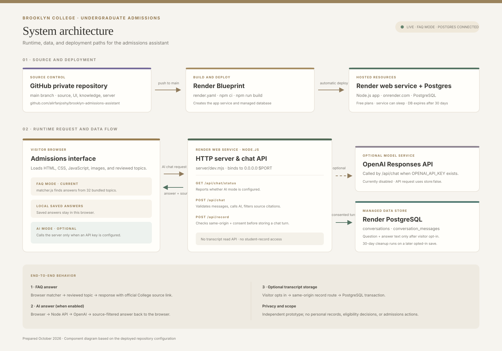

# Brooklyn College Admissions Assistant — System Architecture

This architecture overview is for the project presentation. It describes how a visitor question travels through the deployed application, how source code reaches Render, and where consented chat text is stored.

## Component responsibilities

| Component | Responsibility |
| --- | --- |
| GitHub private repository | Holds the application source on `main`. A push triggers Render’s connected deployment. |
| Render Blueprint | Reads `render.yaml`, builds the project, and provisions the Node web service and PostgreSQL database. |
| Visitor browser | Loads the interface and the reviewed admissions topics. The FAQ matcher runs in the browser and links answers to official College pages. |
| Node.js web service | Serves the site, exposes the chat status, AI chat, and consented-recording routes, validates requests, and filters AI citations to approved sources. |
| OpenAI Responses API | Optional language generation service. The live deployment is currently in FAQ mode because `OPENAI_API_KEY` has not been configured. |
| Render PostgreSQL | Stores conversation and message rows only after the visitor opts in. There is no visitor-facing transcript-read route. |
| Brooklyn College admissions pages | Official source pages linked from answers. The assistant does not read student records or make admissions decisions. |

## Request and data flow

1. A visitor opens the Render URL. The Node service returns the HTML, styles, scripts, images, and knowledge bundle.
2. In FAQ mode, the browser matches the question against reviewed admissions topics and displays an answer with its official source link.
3. If `OPENAI_API_KEY` is configured, the browser checks `/api/chat/status` and can send the conversation to `/api/chat`. The Node service validates the request, calls the OpenAI Responses API with `store:false`, accepts only known source IDs, and returns the answer and source links.
4. If the visitor checks the save-consent control, the browser posts the question and answer to `/api/record`. The Node service writes them to PostgreSQL under a random conversation ID. Without consent, no transcript is sent to the database.
5. Expired conversations are deleted when a later opted-in message is recorded. This cleanup is opportunistic, so old rows can remain longer while the service is idle.

## Deployment flow

`main` push → GitHub → Render Blueprint (`render.yaml`) → `npm ci` and `npm run build` → `npm start` → Render web service and PostgreSQL.

The service listens on Render’s `PORT` and binds to `0.0.0.0` in Render. The database schema is initialized idempotently when the Node service starts.

## Current deployment notes

- Live app: <https://brooklyn-admissions-assistant.onrender.com/>
- The website currently runs in FAQ mode; configure `OPENAI_API_KEY` as a Render secret to enable AI answers.
- Both Render resources currently use free plans. The web service may sleep while idle, and the free Postgres instance expires 30 days after creation.
- This is an independent prototype, not an official Brooklyn College service. Do not use it to collect sensitive student information.

## Editable diagram source

The SVG at [`system-architecture.svg`](system-architecture.svg) is a vector graphic you can open directly in VS Code or insert into slides. The component and flow descriptions above are the editable source notes for updating the diagram.
